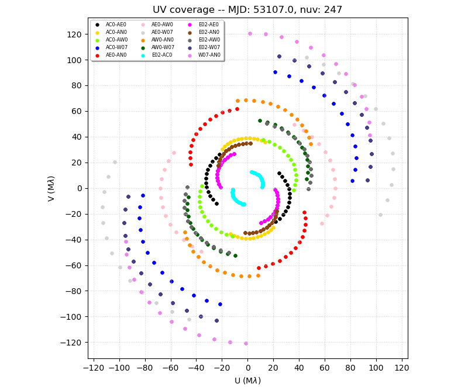
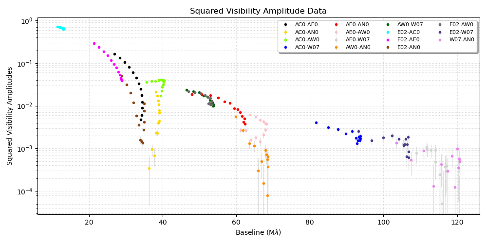
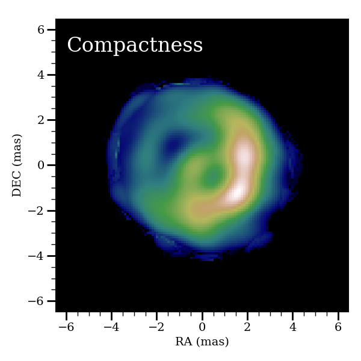
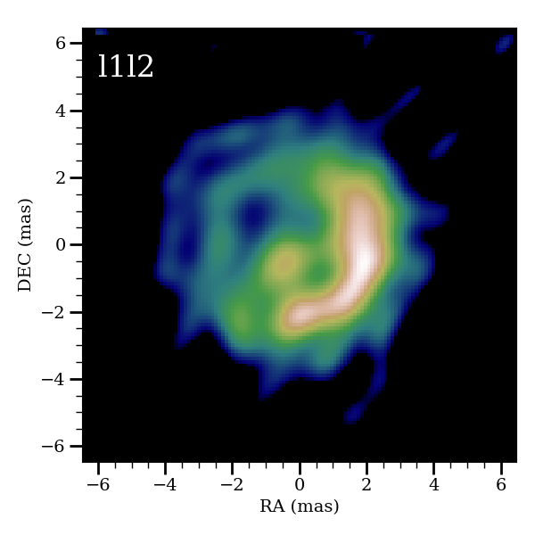
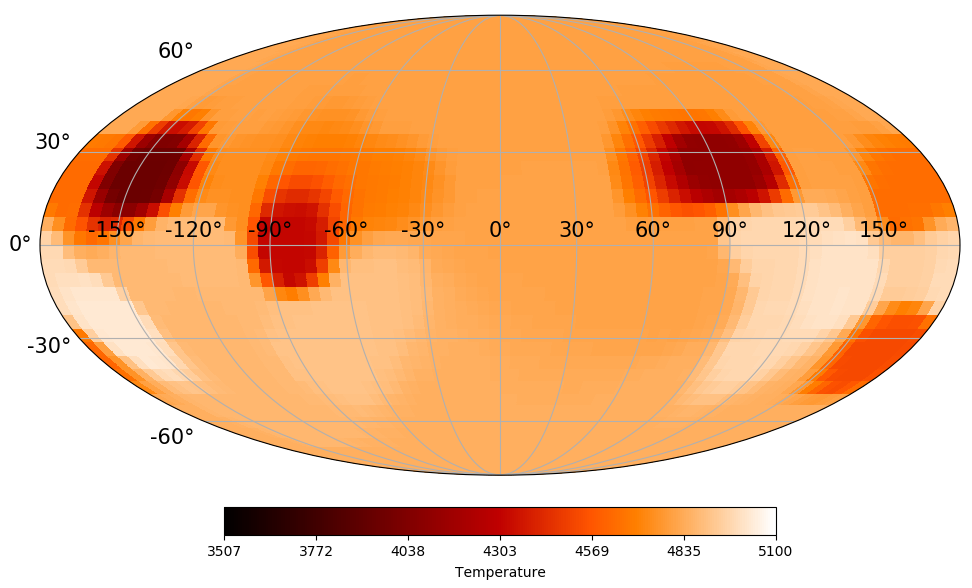
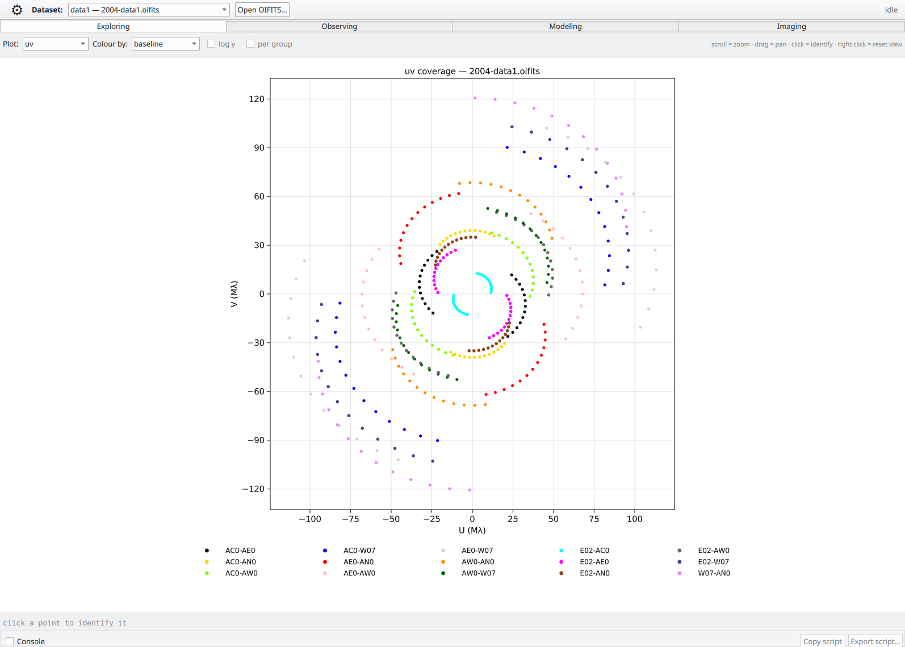
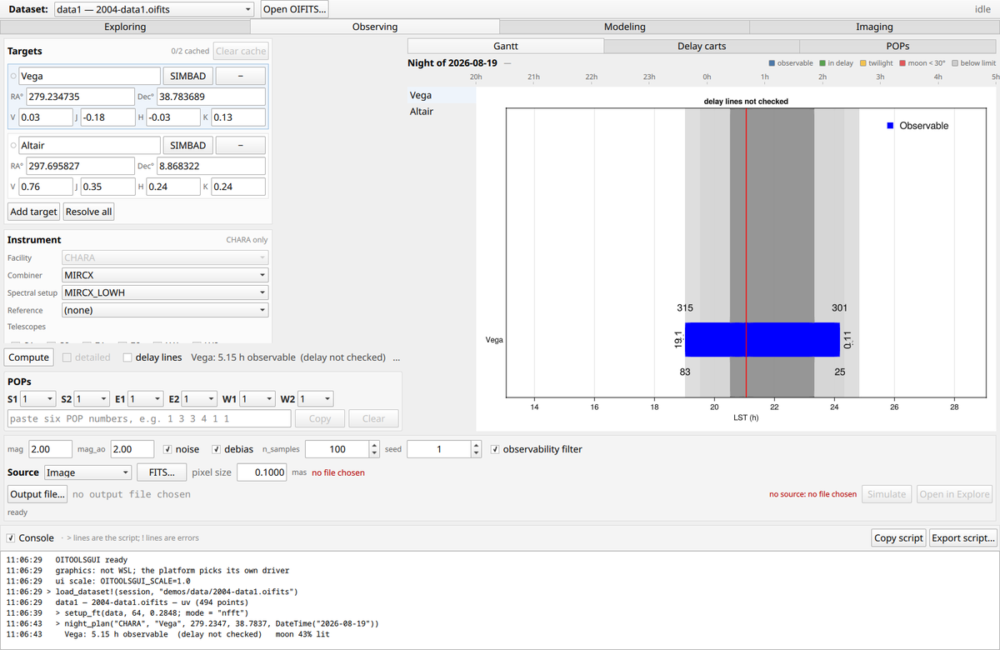
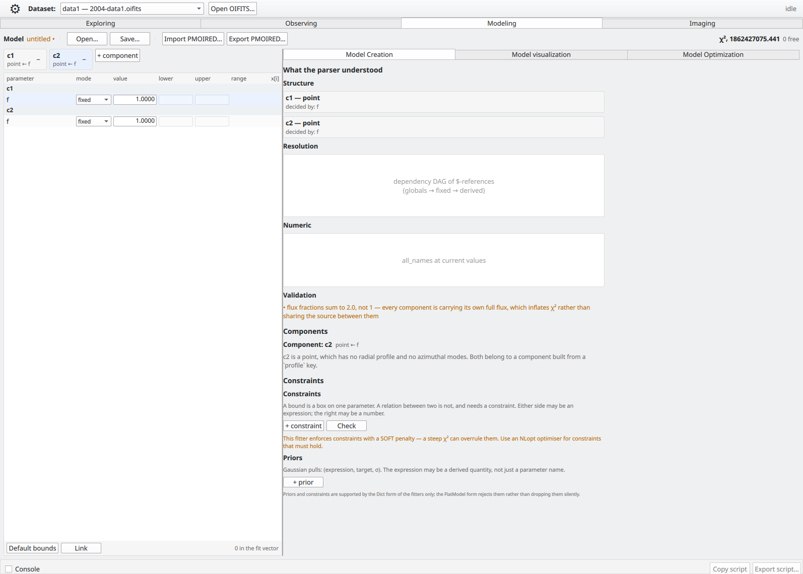
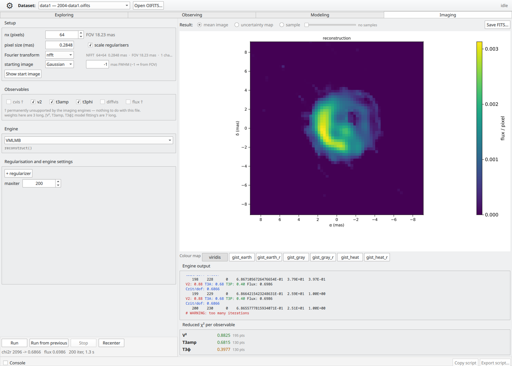

# OITOOLS: the All-in-One Tool Package for Optical Interferometry

|     **Status**                  | **Documentation**               | **License**                     |**Build**                      |
|:--------------------------------|:--------------------------------|:--------------------------------|:------------------------------|
| [![][proj-img]][proj-url] | [![][doc-dev-img]][doc-dev-url] | [![][license-img]][license-url] | [![][build-img]][build-url] |

[proj-img]: http://www.repostatus.org/badges/latest/active.svg
[proj-url]: http://www.repostatus.org/#active

[doc-dev-img]: https://img.shields.io/badge/docs-dev-blue.svg
[doc-dev-url]: https://fabienbaron.github.io/OITOOLS.jl/dev

[license-url]: ./LICENSE.md
[license-img]: http://img.shields.io/badge/license-GPL3-brightgreen.svg?style=flat

[build-img]: https://github.com/fabienbaron/OITOOLS.jl/workflows/CI/badge.svg
[build-url]: https://github.com/fabienbaron/OITOOLS.jl/actions

OITOOLS is a Julia package for optical interferometry data analysis, developed
by Prof. Fabien Baron (Georgia State University) and collaborators. It covers
the full workflow for data from arrays such as CHARA, VLTI, and NPOI:
reading, plotting, model fitting, image reconstruction, and observation
simulation.

### **[:book: Full Documentation](https://fabienbaron.github.io/OITOOLS.jl/dev)**

> **Note:** Despite having the same name as [JMMC's oitools](https://github.com/JMMC-OpenDev/oitools),
> the two packages are completely unrelated and were developed independently.

## OK, I'm pressed for time, what do I do?

If you just want to use OITOOLS or discover its main capabilities, download the single-file GUI for Linux:

[Download the Linux AppImage GUI](https://www.astro.gsu.edu/~baron/OITOOLS-x86_64.AppImage)

Just make it executable  (`chmod +x OITOOLS-x86_64.AppImage`) and it's ready to run.
Of course using the library itself is more flexible, but this way you can get an idea of what is even possible to achieve.

To run the GUI from the source instead (Julia 1.13 or later):

```bash
git clone https://github.com/fabienbaron/OITOOLS.jl.git
cd OITOOLS.jl
julia --project=bin -e 'using Pkg; Pkg.instantiate()'   # once
julia --project=bin bin/oitoolsgui.jl [file.oifits]
```

## Installation

Julia 1.13 or later:

```julia
using Pkg
pkg"registry add General"
pkg"registry add https://github.com/emmt/EmmtRegistry"
Pkg.add(url="https://github.com/fabienbaron/OITOOLS.jl.git")
Pkg.add("GLMakie")             # for the *_makie figures
using OITOOLS
```

`using OITOOLS` loads no plotting package, no Python and no GUI. Figures need a plotting package:

- **Makie** (recommended): with any Makie backend loaded (`GLMakie` for windows, `CairoMakie`
  for files), the `*_makie` functions draw: `uvplot_makie`, `plot_v2_makie`,
  `plot_t3phi_makie`, `imdisp_makie`, …
- **PythonPlot**: the functions without a suffix (`uvplot`, `plot_v2`, `imdisp`, …) draw with
  matplotlib. The test suite checks that both draw the same values.

Python is needed only for PythonPlot and for the UltraNest sampler; CondaPkg installs it the
first time PythonCall is loaded. The
[installation guide](https://fabienbaron.github.io/OITOOLS.jl/dev/install/) lists every optional
package.

## Quick start

```julia
using OITOOLS, GLMakie
data = readoifits("mydata.oifits")
uvplot_makie(data)
plot_v2_makie(data)
plot_t3phi_makie(data)
```

With matplotlib:

```julia
using OITOOLS, PythonPlot
uvplot(data); plot_v2(data); plot_t3phi(data)
```

## Features

Images and parametric models are used the same way:

| Operation | Image | Model |
|-----------|-------|-------|
| → complex visibilities | `image_to_vis(x, ft)` | `model_to_vis(model, x, uv)` |
| → observables | `image_to_obs(x, ft, data)` | `model_to_obs(model, x, data)` |
| → residuals | `image_to_residuals(x, ft, data)` | `model_to_residuals(model, x, data)` |
| → chi² | `image_to_chi2(x, ft, data)` | `model_to_chi2(model, x, data)` |
| → chi² + gradient | `image_to_chi2_fg(x, g, ft, data)` | `model_to_chi2_fg(model, x, data)` |

### Reading OIFITS data

- OIFITS v1 and v2, with quality filtering
- Spectral and temporal binning; polychromatic (per-channel) datasets
- OI\_CORR correlation matrices (e.g. GRAVITY)
- `Float32` or `Float64` (`readoifits(file; T=Float64)`)
- Tools: header and table viewer, validator, repair, splits and merges

### Plotting

Plot functions take `color="baseline"` (default), `color="wav"` or `color="mjd"`.

```julia
plot_v2(data; logplot=true, color="wav")        # one observable
plot_obs(data)                                   # V², T3φ, T3amp
plot_obs(data; obs=["V2","T3PHI","VISAMP"], color="mjd")

obs = image_to_obs(x, ft, data)                 # or model_to_obs(model, x, data)
plot_residuals(data, obs)                        # data, model and residuals
plot_residuals(x, ft, data)

imdisp(image; pixsize=0.1)                       # an image
```

|    **UV coverage**                  | **V²**               |
|:--------------------------------:|:--------------------------------:|
|   |  |

### Model fitting

Parametric models as flat dictionaries, compatible with [PMOIRED](https://github.com/amerand/PMOIRED)
(`pmoired_to_julia()` converts PMOIRED dicts):

- **Components:** uniform disk, Gaussian, limb-darkened disks (linear, quadratic, square root,
  power law, four-parameter), ring, Gaussian ring, crescent, point source, background, radial
  profiles (Hankel transform) with azimuthal modes, FITS images and cubes
- **Expressions:** `$WL`, `$MJD` and references between parameters, for chromatic and
  time-variable models; spectral lines; binary orbits, with radial velocities
- **Fitting:** Levenberg-Marquardt, NLopt, grid search (`chi2_map`), companion search,
  multi-start search (`multistart_fit`)
- **Uncertainties and posteriors:** bootstrap; nested sampling with evidence (Nautilus.jl or
  UltraNest); ensemble slice sampling; parallel tempering (Pigeons.jl)

### Image reconstruction

- VMLMB (OptimPackNextGen) with NFFT or DFT
- Polychromatic and time-variable imaging
- SPARCO for chromatic environments
- Maximum entropy (BSMEM), ADMM (BSDMM), SQUEEZE
- Regularizers: total variation, L1-L2, compactness, entropy, support, and more





[ROTIR](https://github.com/fabienbaron/ROTIR.jl/) uses OITOOLS for stellar surface imaging
(light curve inversion, Doppler imaging, interferometric imaging):



### Observation simulation

- Synthetic OIFITS from images, cubes or parametric models
- Arrays, combiners and spectral setups from TOML configurations: CHARA and VLTI (UT, AT), with
  MIRC-X, MYSTIC, SPICA, GRAVITY and MATISSE
- Observation planning: Gantt charts, delay lines, SIMBAD queries

## Graphical interface

One window with five perspectives over one session: Exploring, Observing, Modeling, Imaging and
Tools.

```julia
using OITOOLS
oitoolsgui()                  # or oitoolsgui("mydata.oifits")
```

`oitoolsgui()` loads GLMakie, QMLMakie and QML (install them once with
`Pkg.add(["GLMakie", "QMLMakie", "QML"])`); call it before `using GLMakie`. From a clone, use
`julia --project=bin bin/oitoolsgui.jl` (above).

| **Exploring** — uv coverage and observables | **Observing** — Gantt, delay lines, POP search |
|:---:|:---:|
|  |  |
| **Modeling** — parameters and what the parser understood | **Imaging** — reconstruction with per-observable reduced χ² |
|  |  |

The console shows the OITOOLS call for each action, and **Export script** writes the session as a
Julia script. See the [Graphical interface guide](https://fabienbaron.github.io/OITOOLS.jl/dev/gui/).

## Documentation

[fabienbaron.github.io/OITOOLS.jl](https://fabienbaron.github.io/OITOOLS.jl/dev):

- [Reading OIFITS files](https://fabienbaron.github.io/OITOOLS.jl/dev/examples/reading/)
- [Model fitting](https://fabienbaron.github.io/OITOOLS.jl/dev/examples/modeling/)
- [Image reconstruction](https://fabienbaron.github.io/OITOOLS.jl/dev/examples/imaging/)
- [Simulation and planning](https://fabienbaron.github.io/OITOOLS.jl/dev/examples/simulating/)
- [Demo scripts](https://fabienbaron.github.io/OITOOLS.jl/dev/examples/intro/)
- [Graphical interface](https://fabienbaron.github.io/OITOOLS.jl/dev/gui/)
- API reference: [OIFITS](https://fabienbaron.github.io/OITOOLS.jl/dev/api/oifits/), [Plotting](https://fabienbaron.github.io/OITOOLS.jl/dev/api/plotting/), [Model Setup](https://fabienbaron.github.io/OITOOLS.jl/dev/api/model_setup/), [Model Fitting](https://fabienbaron.github.io/OITOOLS.jl/dev/api/modeling/), [Companions and Orbits](https://fabienbaron.github.io/OITOOLS.jl/dev/api/companions_orbits/), [Imaging](https://fabienbaron.github.io/OITOOLS.jl/dev/api/imaging_setup/), [Observation Planning](https://fabienbaron.github.io/OITOOLS.jl/dev/api/planning/)

## Development install

```julia
using Pkg
pkg"registry add General"
pkg"registry add https://github.com/emmt/EmmtRegistry"
Pkg.develop(url="https://github.com/fabienbaron/OITOOLS.jl.git")
```
